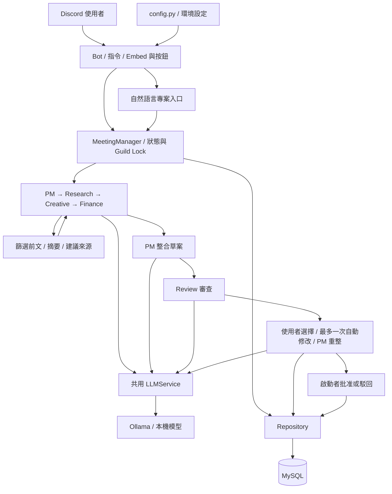

# AI Agent Company

在 Discord 裡，讓 PM、Research、Creative、Finance 與 Review 五個角色共同討論專案，整合草案、整理分歧，再由會議啟動者選擇方向及批准成果。

這是 Python 學習專案，不依賴 LangChain 或 CrewAI。使用 discord.py、Ollama Python SDK、Pydantic 與 MySQL；五個角色共用 LLMService，以不同 System Prompt、參數及 JSON Schema 分工。範例模型是 `qwen3.5:9b`，可以換成 Ollama 已安裝的模型。

> 正式 Bot 使用 **MySQL**。根目錄 JSON 是舊版／本機資料，不是目前主要資料來源。`examples/` 僅保留開發者本機；新使用者可依下方自然語言入口建立自己的專案，不要匯入別人的會議紀錄。

## 架構與資料流



1. 使用者啟動範例專案，或在入口頻道建立自訂需求。
2. PM 拆解需求；Research、Creative、Finance 依序發言。後發言者只取得需要的前文欄位，不重送全部歷史。
3. 可加入一次需求變更，進行第二輪；PM 將摘要及重要原文整合成固定章節草案。
4. Pydantic 驗證結構、長度與跨欄位規則，另核對草案決策的 Agent 來源與輪次；Review 檢查完整度、創意、可信度與可行性。
5. 使用者選擇方向，產生候選方案並審查；需要修改時最多自動修改一次，再由 PM 整合。
6. 啟動者明確批准後保存成果、完成專案，釋放 Guild 的進行中位置。

Review「通過」與評分不是品質保證，也不等於使用者已批准：模型仍可能誤解需求或產生沒有依據的說法，方案中的技術、成本與驗收內容需要人工核對。目前啟動者仍可批准有剩餘問題的候選方案，請先閱讀風險。`completed` 可能只是某輪討論完成，不一定代表專案已批准。同一 Guild 同時只允許一個進行中專案。

PM 草案的 `decisions.sources` 必須使用當次會議允許的來源標籤，例如 `Finance Agent 第2輪`；同一角色在兩輪發言時，不能只寫角色名稱。系統會將來源清單加入 JSON Schema，並在回覆後再次核對。可重試的驗證錯誤會提供精簡回饋再嘗試，MeetingManager 預設最多執行兩次，不會無限生成；來源驗證只能確認引用對象，不能證明內容正確。

## 安裝與啟動

以下終端機指令以 macOS／Linux 為例。需要 Python（本機測試環境為 3.10.5，建議新環境使用 3.11+）、Docker 與 Compose v2、Ollama，以及 Discord Bot 帳號。較大的模型需要較多記憶體；下載與首次載入可能較久。

### 1. 取得程式與安裝依賴

```bash
git clone https://github.com/JayceKc/Discord-Ai-bot.git
cd Discord-Ai-bot
python3 -m venv .venv
source .venv/bin/activate
python -m pip install -r requirements.txt
cp -n .env.example .env
```

Windows PowerShell 的啟用指令是 `.venv\Scripts\Activate.ps1`。已有 `.env` 時不要覆蓋；用編輯器填寫，不要把真實值貼到聊天室或 Git。

### 2. Discord 帳號、權限與頻道

在 [Discord Developer Portal](https://discord.com/developers/applications) 建立 Application 與 Bot：

- 在 Bot 頁面取得 Token，寫入 `DISCORD_TOKEN`，並開啟 **Message Content Intent**（文字指令與自然語言入口需要）。
- OAuth2 URL Generator 勾選 `bot` 與 `applications.commands`，邀請 Bot 至測試伺服器。
- 給 Bot View Channels、Send Messages、Embed Links、Attach Files、Read Message History 權限。操作者使用 `/cleanup` 需 Manage Messages；不需要給 Bot Administrator。
- 開啟 Discord 開發者模式，以「複製 ID」取得伺服器與頻道 ID。

可手動建立以下頻道並填入 `.env`。入口設成 `0` 會關閉；其他路由未設定時回原頻道，開發事件仍可在終端機查看。

| 頻道用途 | 設定 |
| --- | --- |
| 專案需求入口 | `PROJECT_INTAKE_CHANNEL_ID` |
| Agent 討論 | `AGENT_MEETING_CHANNEL_ID` |
| 專案狀態卡 | `PROJECT_STATUS_CHANNEL_ID` |
| 開發事件，建議限制管理員閱讀 | `DEV_LOG_CHANNEL_ID` |

Bot 必須能讀寫指定頻道；不要填類別或其他伺服器 ID。

### 3. 填寫環境設定

[.env.example](.env.example) 提供設定。至少填入三個空白值：

| 設定 | 用途 |
| --- | --- |
| `DISCORD_TOKEN` | Bot 登入憑證 |
| `DB_PASSWORD` | 自行設定的 MySQL 應用程式強密碼 |
| `MYSQL_ROOT_PASSWORD` | 另一個不同的強密碼，供 Docker 初始化管理帳號 |

Docker 範例對應 `DB_HOST=127.0.0.1`、`DB_PORT=3307`、`DB_NAME=ai_company`、`DB_USER=ai_company_app`；容器內是 3306。其他 MySQL 需自行建立資料庫、套用 migration，並給應用帳號 CRUD 權限。

`OLLAMA_HOST=http://localhost:11434`、`OLLAMA_MODEL=qwen3.5:9b`、`OLLAMA_TIMEOUT_SECONDS=300` 可調整。模型名稱須與 `ollama list` 一致；未設定模型時程式預設仍是 `qwen3.5:4b`。

`DISCORD_GUILD_ID` **不是立即同步測試指令的開關**：本專案同步全域 CommandTree；填入 ID 是為了清除那個伺服器的舊版專用指令，避免兩個 `/status`。不需要清除時留 `0`。

### 4. 啟動 Ollama

安裝 [Ollama](https://ollama.com/) 並開啟應用程式，再執行：

```bash
ollama pull qwen3.5:9b
ollama list
curl http://localhost:11434/api/tags
```

若沒有背景服務，可在另一個終端機執行 `ollama serve`。`address already in use` 表示 11434 已被使用，先查 `/api/tags`，不要重複啟動或直接殺未知程序。換模型也要改 `.env` 並重啟 Bot。

### 5. 初始化全新的 MySQL

先啟動 Docker，再執行：

```bash
docker compose up -d mysql
docker compose ps
docker compose exec mysql mysql -uai_company_app -p ai_company -e 'SHOW TABLES;'
```

最後一行提示輸入 `DB_PASSWORD`，不要將密碼寫在命令列。等待容器 healthy，應可看見專案、會議與工作區等資料表。

Compose 使用持久 volume，**只有空白 volume 首次初始化**才執行 `database/migrations/`。已有資料庫時，改 `.env` 不會重設密碼，也不會補跑新增 migration。先備份再升級；不要用 `docker compose down -v` 排錯，它會刪資料。

### 6. 設定新專案入口

發佈版本不包含 `examples/`。全新資料庫的 `/projects` 可能是空清單，這是尚未建案，不代表初始化失敗。

在 Discord 建立需求入口頻道，將其 ID 寫入 `PROJECT_INTAKE_CHANNEL_ID`，確保 Bot 可讀寫。若留 0，自然語言建案會關閉。啟動 Bot 後依下一節描述需求並確認，專案會保存到 MySQL，不需要先匯入種子資料。

`scripts/migrate_json_to_mysql.py` 保留為開發／升級工具，不是一般使用者的必要啟動步驟。它會更新相同 ID 的專案，但拒絕所有權衝突；相同會議略過，不同內容的既有會議拒絕覆蓋，新會議不沿用來源 storage_version。匯入不是整批原子交易；先備份、停 Bot 並在隔離資料庫驗證，不省略私人資料的路徑參數，不對正式資料庫隨意重跑。

### 7. 啟動 Bot

每次啟動前確認：目前模型已安裝、Ollama 與 MySQL 可用、`.env` 指向正確的測試環境，而且沒有另一個 Bot 程序。閱讀本文排錯與安全提醒；已有進行中專案時先查 `/status`，不要重置資料重開。

```bash
python bot.py
```

發佈版本不包含開發者的 `tests/`、手動測試與開發紀錄，不必執行它們才能啟動。這些檔案僅在開發者本機保留：如本機有 `tests/`，可執行 `python -m unittest discover -s tests -v`；如有 `manual_test.py`，可用它檢查真實 Ollama。Fake 測試不代表實際服務可用，手動模型測試則會實際推論。

保持終端機開啟；看到登入與同步訊息後，在 Discord 測 `/hello`、`/help`、`/projects`。目前有 14 個 Slash Command。全域指令可能需要等候或刷新 Discord；確保只有一個 Bot 程序。按 Ctrl+C 停止。

## 第一次操作

先在已設定的需求入口頻道輸入「我要做一個咖啡店網站」，依 Bot 問題補齊：

- 名稱與類別，例如「咖啡店官網」、「網站」。
- 需求，例如菜單、門市資訊與聯絡表單。
- 整數預算、YYYY-MM-DD 格式期限與驗收條件。

確認預覽後回覆「確認」，等待四位 Agent 第一輪討論及 PM 草案。未完成填表暫存有期限，Bot 重啟不恢復；已保存的專案與會議仍在 MySQL。

建案前會檢查需求與驗收合併長度並預留模型上下文空間；過長時可回覆「修改需求：較短內容」或「修改驗收：較短內容」，再確認。若需求變更顯示保存結果不確定，回覆「查證」；查證成功後用「重試」接續第二輪，不再次新增變更。

前文超限時先移除重複建議與近期參考，再精簡相關 Agent 前文；完整原文仍保存。需求、需求變更與審查目標不會靜默截斷，必要資料本身超限仍會拒絕。`/resume` 會顯示接續的 Agent 發言；回到入口輸入「重試」時，已完成的討論不會再執行。

1. 草案後回覆「直接定稿」進入審查／決策；若需變更，可回覆「修改：具體變更」，進行一次第二輪。
2. 啟動者按實際選項按鈕，或 `/decide choice:A`（也可 B／C，須有該選項），等待候選方案與審查／必要的一次自動修改。
3. 先讀剩餘問題，再 `/decide choice:approve` 批准保存，或 `reject` 駁回候選方案。`/workspace` 查看成果數，`/status` 查看階段。

「直接定稿」不等於自動批准。若資料庫已有可用專案，也可用 `/projects` 查看實際 ID，再以 `/start project_id:實際ID`、可選的 `/change change_id:實際變更ID`、`/draft`、`/review` 操作。不要照抄不存在的 PRJ／CHG ID。

第二輪已套用需求變更後，不能再新增第二次變更；完成第二輪就用 `/draft` 整合，再用 `/review` 進入審查／決策。不要為了重試而重置 JSON 或修改資料庫狀態。

### 失敗或重啟後怎麼接續

先用 `/status` 查看保存狀態，再依錯誤卡的下一步操作：

| 目前情況 | 接續方式 |
| --- | --- |
| 討論中斷，尚有 Agent 未完成 | 使用 `/resume` 接續剩餘步驟；不適用所有決策錯誤 |
| 討論已完成，但 PM 整合草案失敗 | 使用 `/draft` 重試；不需重跑兩輪或再次套用需求變更 |
| 已有草案，需要審查或接續決策 | 使用 `/review`；不會重設已使用的修改次數 |
| 選項套用失敗或保存結果不確定 | 依錯誤卡查證、重試同一選項，不自行改版本或換選項 |
| Bot 重啟前只填了表，尚未提交 | 重新填表；這類入口暫存不恢復 |

已保存的專案、會議與草案仍在 MySQL。已有草案時 `/draft` 可再次顯示已保存內容，不是每次都重新推論；這不代表所有階段均能自動恢復。錯誤卡若指示先修復 Ollama、MySQL 或權限，先處理原因再重試。

`/meeting` 的 project_id 與 change_id 皆必填，會跑兩輪至決策，不會代替批准。共用種子專案的狀態不是每個 Guild 各一份；跨伺服器不要搶用同一專案。

## Discord 指令

| 指令 | 參數 | 用途／限制 |
| --- | --- | --- |
| `/hello` | 無 | 打招呼 |
| `/help` | 無 | 說明、defer／followup 練習 |
| `/projects` | 無 | 專案與可用需求變更 ID |
| `/workspace` | 無 | 工作區、優先目標及成果數 |
| `/priority` | `priority` | 成長／成本效益／品牌影響／創新；需 Manage Guild，影響下一場會議 |
| `/start` | `project_id` | 啟動第一輪；同一 Guild 不可重複啟動 |
| `/change` | `change_id` | 目前專案的變更，最多一次第二輪 |
| `/meeting` | `project_id`、`change_id` | 皆必填；完整討論至決策 |
| `/draft` | 無 | 建立／重試 PM 草案，或顯示已保存草案摘要 |
| `/review` | 無 | 審查／目前決策階段；不重設修改次數 |
| `/decide` | `choice` | A／B／C／approve／reject；僅啟動者、依階段與版本驗證 |
| `/status` | 無 | 私人回覆階段、操作者與下一步 |
| `/resume` | 無 | 接續討論失敗步驟，不適用所有決策失敗 |
| `/cleanup` | 無 | 需 Manage Messages；掃描目前頻道最近 100 則，刪本 Bot 訊息，保留使用者訊息與資料庫 |
| `!hello` | 無 | 學習用文字指令 |
| `!ask` | 問題文字 | 使用目前模型；預設輸入 500、顯示輸出 1900 字元 |

`/cleanup` 刪除的 Discord 訊息無法復原，也不是重置專案。失敗時依錯誤卡下一步重試；選項套用中失敗通常要重試**同一選項**，不要自行切換或改資料庫版本。

## 畫面說明

五位 Agent 在 Embed 顯示角色，不是五個獨立 Discord 帳號。目前發佈版本尚未附上畫面截圖；請依實際操作查看角色發言、決策選項與狀態卡，不以歷史畫面代替當次驗收。

## 檔案分工

```text
bot.py                     Discord 入口、指令及依賴組裝
config.py                  統一讀取／驗證設定
agents/                    共用基底及專業角色
models/                    專案、會議及決策模型
services/                  LLM、會議、需求入口、品質及決策
repositories/              介面、MySQL 與舊 JSON 實作
database/migrations/       MySQL 初始化／升級
presentation/、views/      Embed、錯誤卡、進度及按鈕
examples/                  本機教學資料，不納入 Git 發佈版
tests/                     本機開發測試，不納入 Git 發佈版
.runtime/                  狀態訊息索引（忽略 Git）
```

正式 Agent 使用 `services/llm_service.py` 的 Ollama SDK。舊的手寫 HTTP API 學習版已移除。詳細設計與踩雷紀錄見 [TECHNICAL_GUIDE.md](TECHNICAL_GUIDE.md)。測試、`docs/`、計畫、報告與測試教學僅保留開發者本機，不包含在 GitHub 發佈版。

## 排錯與安全

- **看不到專案**：全新 MySQL 尚未建案時可為空清單；設定入口頻道後按提示建立專案。改根目錄 JSON 不會更新正式 Bot。
- **MySQL Access denied**：核對應用帳號、主機、3307 與既有密碼。改 `.env` 不是密碼重設；保留 volume 並先備份。舊資料庫依 `database/migrations/` 補跑缺少 migration，不能只重啟。
- **兩個 /status**：可能同時有全域與伺服器指令；設定對應 `DISCORD_GUILD_ID` 後重啟清除舊副本，再刷新。不要另建專用指令補救顯示延遲。
- **Agent 失敗**：讀錯誤卡原因、保存狀態、下一步與查詢代碼；在 Bot 終端機找同碼。檢查服務、逾時、JSON 與截斷，不要無限制提高上限。
- **PM 草案來源驗證失敗**：來源須對應已完成的角色與輪次。先依錯誤卡重試 `/draft`；若仍失敗，保留查詢代碼供排查，不手動補成猜測的輪次，也不靠提高輸出上限繞過驗證。
- **字元不等於 Token**：Prompt／回覆字元預算、模型 `num_predict` 與 Discord 顯示上限是不同限制。Schema 可抓格式，但不能保證內容真實。
- **重新測試**：用新專案或隔離測試資料庫，不清空正式資料、重設修改次數，或把 cleanup 當取消會議。
- **不提交私人資料**：`.env`、日誌、會議 JSON、MySQL 匯出及 `.runtime/` 都不應公開。`.gitignore` 不會撤回已提交檔案；Token 曾外洩就必須撤銷換新。
- **本機推論不等於全部離線**：Discord 收到發言，MySQL 保存完整 Agent 輸入／輸出。不要送入不能分享的個資；日誌只記安全事件，不印 Token、密碼、完整 Prompt 或原始 SQL 錯誤。

測試假密碼不能直接部署。全新機器的硬體、網路、Discord 權限與空白 volume 初始化仍需實測；Fake 測試不能取代它們。

參考：[discord.py](https://discordpy.readthedocs.io/en/stable/)、[Ollama CLI](https://docs.ollama.com/cli)、[Docker Compose](https://docs.docker.com/compose/)。
