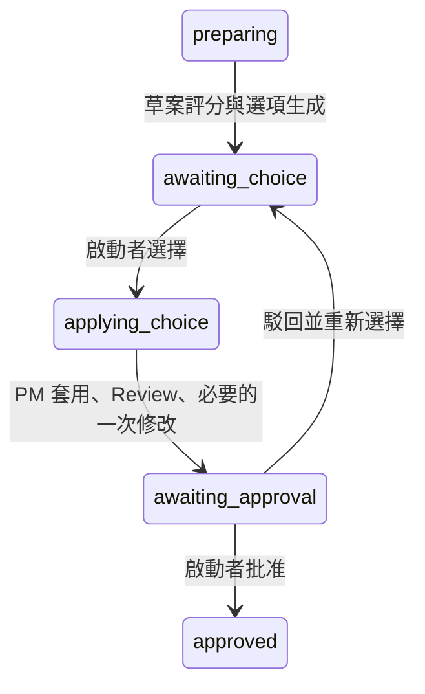

# AI Agent Company 技術文件與踩雷紀錄

更新日期：2026-10-12。本文依目前程式整理，不是某一天的實測報告。

[README](README.md) 負責安裝、啟動與指令操作；本文說明架構、資料、限制與排錯。每次執行前先確認 README 的啟動條件及本文的恢復／安全規則。測試、計畫、每日報告與教學僅保留本機，閱讀本文不需要那些檔案。

## 1. 架構與責任邊界

### 1.1 系統概念

單一 Discord Bot 用五種角色 Embed 呈現 PM、Research、Creative、Finance、Review。角色不是五個 Discord 帳號，也不是五個不同模型；目前共用一個 LLMService，靠角色 Prompt、參數與 Schema 分工。不使用 LangChain 或 CrewAI。

```text
Discord 指令／入口訊息
  → Bot 與展示層
  → MeetingManager／UserDecisionService
  → 專業 Agent → StructuredAgent → BaseAgent
  → 共用 LLMService → Ollama
  → Pydantic 與程式品質檢查
  → Repository → MySQL
  → Discord 發言、狀態與操作卡
```

### 1.2 檔案分工

| 模組 | 責任 |
| --- | --- |
| `bot.py` | 組裝相依物件、註冊指令、處理 Interaction、連接服務與展示 |
| `config.py` | 讀取環境設定並驗證型別／範圍 |
| `agents/base_agent.py` | 名稱、角色、System Prompt、生成參數與統一 respond 介面 |
| `agents/structured_agent.py` | 呼叫 BaseAgent，解析／驗證結構化輸出與回傳用量 |
| `agents/*_agent.py` | 各角色的專業內容、Schema 與參數 |
| `services/llm_service.py` | SDK 呼叫、message.content、耗時與 Token 統計、連線錯誤轉換 |
| `services/meeting_manager.py` | 發言順序、共享 Context、輪次、保存檢查點及失敗恢復 |
| `services/user_decision_service.py` | 選擇、一次修改、重整、批准／駁回與版本驗證 |
| `services/project_intake.py` | 自然語言需求收集的暫存階段 |
| `services/project_submission_service.py` | 建案結果查證，避免不確定寫入被重複提交 |
| `models/` | 專案、會議、決策與合法狀態 |
| `repositories/`、`database/` | 資料存取、交易、連線池與 migration |
| `presentation/`、`views/` | Embed、分頁、進度、頻道路由與持久按鈕 |
| `core/` | 錯誤分類、安全日誌、恢復與文字完整性檢查 |

Bot 不應重複撰寫 SQL、模型解析或角色業務規則。Repository 不負責決定 Agent 如何發言。

### 1.3 設定與共用模型

設定經 `load_settings()` 形成 Settings，再由啟動流程注入服務；正式 LLMService 不自行讀取環境變數。環境中已有的值優先於 dotenv 預設載入的值。

[.env.example](.env.example) 使用 `qwen3.5:9b`；程式未取得模型設定時仍以 `qwen3.5:4b` 作為預設。實際模型以執行環境的 OLLAMA_MODEL 為準，不是看 Agent 檔名。換模型後需安裝對應模型並重啟 Bot，不必改每個角色。

正式服務使用 Ollama Python SDK；手寫 HTTP API 學習版已移除。httpx 仍供 SDK 版辨識連線／逾時錯誤，不應一併移除。

## 2. 完整流程

### 2.1 專案入口與隔離

有兩種入口：

- `/projects` 選取種子專案，再 `/start project_id:...`。
- 在設定的需求入口頻道描述需求，依 Bot 提示補齊欄位及確認，建立自訂專案。

自然語言入口限定 PROJECT_INTAKE_CHANNEL_ID，設為 0 就關閉。明確啟動句可直接收集，其他句子交由 ProjectIntentAgent 分類；不確定時要求確認，不能因一般聊天就任意建案。填表暫存以 Guild／頻道／使用者區分，Bot 重啟不恢復未完成的對話；已保存的資料仍在 MySQL。

共用種子專案的 owner_guild_id 為 NULL，自訂專案則綁定所屬 Guild。種子專案的狀態是共用的，不是每個伺服器各一份。

Guild Lock 防止同一程序內同一 Guild 重複啟動；資料庫也保存目前專案並檢查交易／版本。不同 Guild 可討論不同專案，但不要同時啟動同一共用種子。此架構不代表可任意運行多個 Bot 副本，記憶體 Lock 並非跨程序分散式鎖。

### 2.2 第一輪與共享內容

固定順序是 PM → Research → Creative → Finance。Review 不在第一輪，因為尚未形成整合草案。

| 角色 | 專業輸出 | 第一輪取得的前文 |
| --- | --- | --- |
| PM | 目標、限制、工作、分歧 | 原始需求 |
| Research | 已知資訊、合理推論、待查證 | PM 的目標、限制、工作及分歧 |
| Creative | 具體方案、研究依據、實作步驟 | Research 的已知、推論與待查證 |
| Finance | 成本、限制、風險、替代方案 | PM 限制、Research 已知／待查證、Creative 方案 |

欄位選擇由 MeetingManager 的 RELEVANT_OUTPUT_FIELDS 控制；第二輪使用 SECOND_ROUND_RELEVANT_OUTPUT_FIELDS。後發言者取得的是所需輸出，不是前一位的完整 Prompt。

meeting_context 保存摘要、每輪摘要、建議與來源角色；步驟原文另行保存。存完整歷史不等於每次傳完整歷史。這能控制 Context 大小，但不能消除幻覺；Prompt 要求引用也不代表模型一定引用正確。

### 2.3 需求變更與第二輪

`/change change_id:...` 必須屬於目前專案，一場會議最多套用一次需求變更。四位 Agent 針對新限制或前文各回應一次，不應只說「我同意」。

自然語言入口先展示第一輪草案；「修改：具體內容」才新增變更並進行第二輪。「直接定稿」是進入審查／決策，不代表跳過使用者批准。

也可用 `/meeting project_id:... change_id:...` 一次跑兩輪至決策，兩個參數皆必填；不會自動批准。

### 2.4 PM 整合草案

PM 收到已完成的一輪或兩輪摘要、重要原文、需求及變更，輸出：

- 標題與摘要
- 背景與目標
- 整合方案
- 執行計畫
- 風險與對策
- 驗收標準
- 採用、拒絕與折衷的決策紀錄

草案在 proposal_draft，統計在 proposal_metrics。折衷是取捨，不是把所有矛盾方案都照單全收；需要指出保留什麼、犧牲什麼及理由。

### 2.5 Review、選擇、一次修改與批准

Review 固定輸出「通過」或「需要修改」，評估完整度、創意、可信度、可行性，各為 1～5 整數並有理由。

- 必要問題放 issues，包含問題、修改要求、優先順序及負責 Agent。
- 非必要偏好／歷史參考放 advisories，不能偽裝成硬性驗收要求。
- 「通過」要求完整度、可信度、可行性達必要門檻，且 issues 為空；創意偏好不足可有建議，不一定退修。
- revision_allowed 由程式依狀態及修改次數重新判斷，不直接信任模型。

審查不會直接把初稿存成最終成果。決策流程如下：



選項有 2～3 個，需包含討論來源與影響章節。啟動者用按鈕或 /decide 選擇；程式驗證方案實際落實了選項指定的變更，不能只換摘要。

候選方案需要修改且尚有額度時，程式挑選優先問題、交給指定 Agent，保存修改結果，再由 PM 重整並重新審查。**一場會議最多一次自動修改**；重試、駁回或換方向不會重設 revision_count。

候選方案與評分對應後，啟動者可 approve／reject。批准檢查版本與摘要雜湊，**目前不會因 Review 仍顯示「需要修改」而一律禁止批准**；批准者必須閱讀剩餘風險，這不是自動品質保證。

## 3. 資料保存、版本與狀態

### 3.1 正式資料在 MySQL

| Repository | 保存內容 |
| --- | --- |
| MySQLProjectRepository | 專案、需求、驗收與變更 |
| MySQLGuildProjectStore | Guild 的進行中專案 |
| MySQLMeetingRepository | 會議、步驟、最新會議索引與決策資料 |
| MySQLWorkspaceRepository | 工作區、優先目標、成果數與同類專案近期經驗 |

新會議保存優先目標與近期完成經驗的快照；之後調整 /priority 只影響下一場，不回頭更改已開始會議。近期成果不是外部查證資料，也不能自動變成新專案的硬需求。

### 3.2 草案與成果在哪裡

以下是 MeetingRecord 的欄位概念，不代表每個欄位都是獨立 SQL 欄位：

```text
MeetingRecord
├── steps                         每位 Agent 的輸入、輸出、輪次、狀態、用量
├── meeting_context               篩選內容、摘要、建議來源、優先目標快照
├── applied_requirement_change    本次變更
├── proposal_draft / proposal_metrics
├── review_result                 初稿審查
├── revision_count / revision_output
├── user_decision                 選項、選擇、影響、評分與歷史
├── candidate_proposal / candidate_review / candidate_proposal_metrics
├── final_proposal / final_proposal_metrics
├── decision_version              決策與舊按鈕防護
└── storage_version               保存版本防護
```

步驟保存 agent_name、order、round_number、input_text、output_data、狀態、字元、Token、耗時與安全錯誤。round_number 是程式寫入的標記：建立第一輪填 1，第二輪填 2；不是 Python 自動猜測輪次。

候選與修改後評分保存在 user_decision.evaluations 及 candidate_review；批准／駁回時將該輪方案與評分記入 user_decision.history。尚未批准的候選內容不算最終成果。

### 3.3 兩種狀態不能混淆

MeetingStatus 描述執行階段：pending、running、completed、failed、cancelled。decision_status 描述使用者決策：preparing、awaiting_choice、applying_choice、awaiting_approval、approved。

單輪 completed 不等於專案已批准。新版成果必須經批准寫入 final_proposal；舊版資料另有相容處理，不應手動改狀態冒充完成。

完成保存時，MySQL Repository 在同一交易內標記專案 completed、釋放 guild_current_projects；guild_latest_meetings 保留最新歷史索引。單輪完成或失敗不會釋放目前專案。

### 3.4 版本與交易保護

- decision_version 擋下舊選項／按鈕；批准時比對候選的版本與 SHA-256，避免接受沒審查過的新內容。
- storage_version 擋下過期會議寫入；保存前鎖定資料列，檢查版本。
- 專案啟動、Guild 關聯與會議保存各自使用交易；模型呼叫在資料庫交易外，不長時間持有交易等待推論。
- 選擇先保存再執行，處理保留期限為 15 分鐘。正常失敗會清除保留；程序中斷時依提示等待期限後重試相同選項。
- /projects 可隔離異常專案，顯示有效項目及警告；這不是自動修復。啟動單筆仍嚴格驗證，不能自行杜撰缺少的驗收內容。

### 3.5 JSON 只用於匯入與相容工具

JsonProjectRepository 供範例匯入等工具使用；JSON Meeting／Guild Repository 也供本機測試替換資料來源。正式 Bot 的啟動組裝使用 MySQL。

修改根目錄 projects.json、meetings.json 或 guild_projects.json **不會重置正式資料庫**。本文不提供清空正式會議的步驟。重新測試使用新專案或隔離資料庫；範例匯入會更新相同 ID，僅適合空白測試資料庫。

MySQL migration 位於 database/migrations。Docker 空白 volume 首次初始化會執行；已有 volume 不會補跑新增 migration，也不會因修改 .env 自動改密碼。升級前先備份，不用刪 volume 作為排錯手段。

## 4. 模型與輸出預算

### 4.1 三層約束

LLMService 以非同步 SDK 呼叫 /api/chat，送出 stream=false、think=false；使用角色消息、temperature、seed、num_predict 及指定 JSON Schema，最後解析 message.content。

1. BaseAgent 控制呼叫、逾時及生成參數。
2. StructuredAgent 使用 Pydantic 驗證型別、必填欄位、額外欄位、字串／陣列長度及跨欄位一致性。
3. 服務層再檢查完整收尾、來源與選項實際影響；格式合法不代表事實可信。

think=false 用來減少思考輸出占用預算，不能保證 JSON 一定完整。固定 seed 與低溫度可提高穩定性，但模型／版本／硬體等仍影響輸出。

### 4.2 目前預設值

以 config.py、各角色 AgentConfig 為準：

| 限制 | 預設 |
| --- | --- |
| !ask 輸入／顯示輸出 | 500／1900 字元 |
| 會議訊息相容預算 | 1900 字元 |
| 單次 Agent Prompt／結構化回覆 | 6000／4000 字元 |
| Ollama Client 請求逾時 | 300 秒 |
| PM 整合草案 | 180 秒、1600 輸出 Token |
| PM 決策選項 | 180 秒、1400 輸出 Token |
| PM 套用選擇 | 180 秒、1800 輸出 Token |
| PM 局部章節修改 | 180 秒、450 輸出 Token |
| MeetingManager 單一步驟嘗試 | 最多 2 次（含首次），預設間隔 1 秒 |

全域 Client 的 300 秒不會取消角色層較短逾時的限制。各角色可覆寫參數，需分辨角色與整體設定。

字元不等於 Token：JSON 鍵、標點與中文都占預算。Python 請求耗時也不等於 Ollama 純推論時間，包含等待與其他請求工作。統計缺失就顯示缺失，不猜總 Token。

### 4.3 截斷與局部修復

PM 選擇套用採較短文字目標，Schema 硬上限仍保留。若驗證指出部分章節未收尾，現行修復流程可要求 PM 只重寫那些章節，再合併與重新驗證，不要求每次重生成整篇。

這是模型輸出格式／完整性修復，**不是增加一次業務方案修改額度**。仍受最大嘗試、Schema、文字預算與逾時限制，不會無限重試。

排查順序：服務與模型是否可用 → 請求耗時 → 輸出 Token 是否到頂 → 字元／Schema／未收尾欄位 → Prompt 是否太長。不是遇到 error 就全面放寬限制；Schema 太複雜或能力不足也可能失敗。

### 4.4 可解釋品質分數

Review 提供四項 1～5 整數，Python 依優先目標計算加權分數，不採信模型算出的總分：

| 優先目標 | 完整度 | 創意 | 可信度 | 可行性 |
| --- | ---: | ---: | ---: | ---: |
| 成長 | 30% | 25% | 15% | 30% |
| 成本效益 | 20% | 10% | 25% | 45% |
| 品牌影響 | 25% | 20% | 40% | 15% |
| 創新 | 20% | 45% | 15% | 20% |

公式版本為 day24-v1：weighted_score = Σ(score × weight)，quality_index = weighted_score / 5 × 100。保留評分理由、受評版本、權重與風險。相同輸入得到相同計算結果，但**總分高不等於審查通過，更不等於已批准**。

## 5. Discord 展示與查詢

### 5.1 Interaction 與狀態頻道

長時間操作先 defer，後續更新原回應或送 followup，不能再用第一次 response.send_message。

公開狀態卡與 /status 不同：

- 狀態頻道：Bot 更新供大家查看的階段卡。
- /status：每次指令回傳私人查詢卡，必須完成本次 Interaction，不能只編輯上一張卡。
- 決策成功提示是保存確認，不會自動執行 /status。

公開 defer 後的錯誤要經 safe_error_reply 處理，不能只加 ephemeral 就假設不會公開；無法確認回覆狀態時不冒險送出敏感細節。

### 5.2 角色卡片與訊息長度

agent_profiles 定義角色名稱、emoji、色碼。message_chunks 按 Embed description、fields、總長度等限制分頁，保留換行並預留頁碼與識別資訊。正式展示可能有多頁，不能只用 1900 字元推斷所有 Embed 限制。

技術用量送到 dev-log／終端機，不把完整 Prompt 寫進 Discord 技術日誌。討論內容本身仍會傳到 Discord。

### 5.3 路由與去重

設定入口、會議、狀態與 dev-log 四種頻道，路由檢查 Guild 與權限。公開用途的傳送遇到 Forbidden／NotFound（403／404），且有不同的原頻道可用時，才可能回退原頻道；dev-log 不用這種回退。

網路、timeout 或 5xx 可能已送出但回應丟失，不能盲目補發，否則可能出現兩張操作卡。狀態卡編輯失敗與一般新訊息回退也不是完全相同的路徑。

狀態卡索引在 .runtime/status_messages.json，重啟後可恢復編輯原卡；不要隨意刪除索引。歷史上已重複的卡不會自動消失。決策按鈕的 message／channel／version 保存在 decision_messages，啟動時恢復持久 View；按下後服務仍檢查啟動者與版本。

### 5.4 指令同步與畫面清理

setup_hook 同步全域 CommandTree。DISCORD_GUILD_ID 用於清除指定伺服器的舊專用指令，不是立即同步開關。邀請需要 applications.commands；文字入口另需 Message Content Intent。

/cleanup 需操作者有 Manage Messages，掃描本頻道最近 100 則，只刪本 Bot 訊息。**訊息刪除不可復原，也不會清除 MySQL 專案或取消會議。** 不用新增重複指令或清空資料來解決畫面問題。

## 6. 錯誤、保存結果與恢復

### 6.1 錯誤卡與日誌

core/errors 按型別、代碼與 cause 分類；ErrorHandler 統一記錄並由 error_presenter 產生固定安全訊息，不直接反射原始例外。

錯誤卡提供原因、保存狀態、下一步與查詢代碼。日誌在**執行 Bot 的終端機**；本專案基本 logging 不等於已設定固定日誌檔。用同一查詢代碼追蹤，不把整份 .env 或原始 SQL 錯誤貼到聊天室。

### 6.2 保存結果要區分

| 結果 | 含義 | 操作原則 |
| --- | --- | --- |
| not_started | 尚未進行寫入 | 修正輸入／環境後照提示操作 |
| rolled_back | 已回滾 | 依錯誤卡重試 |
| committed | 已保存 | 查狀態，避免重複提交 |
| unknown | 無法確定是否保存 | 先查證，不假設「失敗就沒寫入」 |

MySQL 連線池與資料庫操作有各自期限，預設 acquire 10 秒、operation 30 秒、recycle 300 秒。借出前驗證連線；交易中不透明重連或重播寫入。唯讀暫時失敗最多兩次總嘗試，寫入不自動重播。commit 回應不明時保留不確定狀態，不能再寫過期快照掩蓋它。

建案遇到不確定寫入時，ProjectSubmissionService 以實際生成的主鍵查證，不靠相似名稱猜測並重建專案。

### 6.3 如何恢復

- 討論 Agent 失敗：查 /status，依提示 /resume 接續檢查點。
- 初稿／審查失敗：依當前階段使用 /draft 或 /review，不手動改 JSON。
- 選擇套用失敗：照提示 /decide 重試相同選項；尚在保留期間時等待，不改其他選項或版本。
- 私人錯誤回覆失敗：不轉送公開頻道。
- 服務已保存、Discord 發送失敗：不把它改成模型失敗，也不重做已完成的保存。
- Bot 重啟：持久會議及按鈕可恢復，不代表未完成自然語言填表或所有 in-flight 任務會自動接續。

暫時資料庫錯誤可延後持久 View 恢復，背景每 30 秒重試；成功或永久錯誤停止。Discord 同步網路失敗留下安全事件，服務恢復後重啟同步。不是所有失敗都能靠 /resume 解決。

## 7. 安全與資料生命週期

本機模型推論不等於整個系統離線：Discord 接收發言，MySQL 保存完整輸入／輸出。需求可能包含個資，送出前先確認分享範圍。

日誌可記查詢代碼、階段、識別碼、模型、字元、Token、耗時及安全摘要；不記登入 Token、密碼、完整 Prompt 或未處理敏感例外。安全日誌在載入設定前啟用，並更新秘密值遮蔽；未知例外仍只顯示固定錯誤，不展示私人內容。

.gitignore 排除 .env、會議備份、.runtime、日誌、測試及開發紀錄；不會抹除已提交的歷史。若 Token／密碼曾外洩，撤銷或換新，不只刪檔。

MySQL volume、私人匯出與備份必須另外管理，Git 不是資料庫備份。刪 Discord 訊息、刪 JSON、修改 .env、解除 Git 追蹤，分別影響不同層，不是同一個「重置」。

## 8. 踩雷速查

以下是開發時遇到的問題與目前處理方式；不是宣稱本次重做全部實機驗收。

| 問題 | 判斷與目前做法 |
| --- | --- |
| Ollama address already in use | 11434 已被程序占用，先查設定主機的 /api/tags；不要重複 serve 或殺未知程序 |
| Slash Command 看不到／兩個 status | 查 Scope、全域同步、登入、客戶端快取；清舊 Guild 副本，不再新增副本 |
| defer 後仍思考中 | 必須完成本次 Interaction；狀態卡編輯不能代替這次私人回覆 |
| Agent 執行失敗 | 從代碼判斷連線、逾時、JSON、Schema、字元或完整性問題，不把所有錯誤都歸為模型太小 |
| 有 Token，content 卻空白 | 檢查 thinking、輸出預算與實際回覆；think=false 不是萬靈丹 |
| PM 草案／套用選擇逾時 | 比對角色期限與耗時，區分整體 Client 和角色層限制 |
| 加大上限仍失敗 | 可能是 Schema、Prompt、未收尾章節；先做短目標與局部修復 |
| Context 越來越長 | MySQL 保存完整原文，模型只收相關欄位與受控摘要 |
| 固定 Seed 結果仍不同 | 不保證跨版本、硬體或輸入差異時逐字一致 |
| Fake 全過，真實模型失敗 | Fake 驗流程，實機另驗模型品質與環境 |
| 改 Prompt 卻看到舊草案 | 已保存內容可被復用，使用新測試專案，不清空正式紀錄 |
| completed 卻不能開新專案 | 可能只完成一輪，先確認使用者批准與 final_proposal，不手改狀態 |
| Review 不停修改 | 程式鎖定一次業務修改；再次審查或駁回不補額度 |
| 選 A 卻說章節沒改 | 選項必須實際改變指定內容，檢查來源、影響章節與完整性 |
| 同一狀態出現兩張卡 | 區分私人查詢與公開卡，保留索引；送出結果不確定時不補發 |
| Git 誤加入私人檔案 | 查 status 與 staged diff；忽略已追蹤檔仍需解除追蹤，本機檔不必刪除 |

## 9. 開發者本機驗證

此節供持有本機測試檔的開發者。**GitHub 發佈版不包含 tests、manual test、scripts/test_*、計畫或報告；一般使用者依 README 啟動即可。** 不要求下載者先跑不存在的檔案。

本機有 tests 時，可在根目錄的虛擬環境執行：

```bash
python -m unittest discover -s tests
git diff --check
```

Fake 驗證呼叫參數、Schema、Agent 順序、Lock、保存、版本、一次修改與展示錯誤。跳過實機測試不算實機通過，預期失敗情境的 WARNING／ERROR 也不等於測試失敗。

本機有 manual_test.py 且 Ollama 可用時，才能用它驗證真實推論；會實際送出請求。MySQL／Ollama 故障驗收使用隔離測試環境，不停止正式服務來製造錯誤。

新增功能順序：資料模型／狀態 → Schema／Prompt → Fake → 服務編排 → Discord → 整合驗收。從 /projects 到批准成果的完整實測仍需真實服務、權限及測試資料，不能只用單元測試或歷史截圖宣稱完成。

## 10. 參考與閱讀順序

- 安裝、環境、所有指令及圖片：[README](README.md)。
- 設定範例：[.env.example](.env.example)。
- 新專案：依 README 設定自然語言入口建案；examples 僅保留開發者本機，不包含在 GitHub。
- 實作細節：agents、services、repositories、presentation、views、core 的原始碼。
- 套件文件：[discord.py](https://discordpy.readthedocs.io/en/stable/)、[Ollama Python](https://github.com/ollama/ollama-python)、[Pydantic](https://docs.pydantic.dev/)、[Docker Compose](https://docs.docker.com/compose/)。

本文的專案行為以目前原始碼為準；外部套件版本升級時應重新核對官方文件並驗證。模型說法、品質分數、過往成功截圖都不能替代事實查證或當次驗收。
